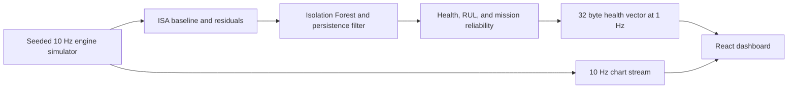

# AstraTwin

AstraTwin is a React + Vite prototype for SIH26054, DRDO's digital twin concept for aero-piston engines in MALE UAVs. The dashboard keeps the existing dark telemetry layout and runs a synthetic edge-to-ground simulation entirely in the browser.

**SIMULATED DATA - SIH26054 PROTOTYPE.** This project does not connect to aircraft sensors, ground stations, or operational maintenance systems. No backend, MQTT broker, InfluxDB, or LLM integration is built.

## Run locally

```sh
npm install
npm run dev
```

Vite prints the local URL. Other useful commands:

```sh
npm run lint
npm test
npm run build
npm run preview
```

Press `F` while running the development server to show or hide the live FPS readout. The optional `?fps=1` query parameter opens the same development readout for measurement. Production builds do not include it.

## Browser simulation architecture



The worker produces normal, high-altitude, injector, lubrication-loss, and CHT sensor-drift scenarios. The charts read from a 300-frame ring buffer. The simulated packet encoder counts raw frames and transmitted health vectors and derives the bandwidth estimate displayed in the header. The protocol assumptions and equations are in [docs/PHYSICS.md](docs/PHYSICS.md).

## Planned architecture

The future service design may use FastAPI for an API, MQTT for telemetry transport, InfluxDB for time-series storage, and an LLM integration for advisory drafting. These services are **planned, not built**. The current dashboard uses local TypeScript code and template-based advisories.

## Prototype measurements

Measurements below came from a foreground in-app browser preview on 30 September 2026. FPS varies with the browser and rendering load.

- FPS readout: 72 frames/s during a settled high-altitude scenario and 93 frames/s during a nominal preview.
- Bandwidth sample: 356 raw bytes/s and 32 transmitted bytes/s, shown as 91.0% estimated savings. The raw estimate uses 36-byte frames at 10 Hz. The health vector is 32 bytes at 1 Hz, including an eight-byte protocol overhead assumption.

These are local prototype measurements, not deployment targets. The browser worker keeps simulation work off the UI thread, the 3D twin is memoized, and its renderer uses a capped pixel ratio. FPS remains dependent on available browser and graphics resources.

## Limitations

- All samples, fault signatures, noise values, engine maps, confidence bounds, and mission reliability values are synthetic prototype assumptions.
- The physics model is intentionally small and does not represent an approved aero-engine thermodynamic model.
- The Isolation Forest is trained on generated healthy residual vectors. Sensor isolation, cylinder attribution, health decay, and RUL fitting need validation against recorded engine data before operational use.
- Advisory text is template-based demo output and requires technician review. It is not maintenance guidance.
- The 32-byte packet and bandwidth calculation model one simulated protocol. They do not include a real transport stack or network measurements.
